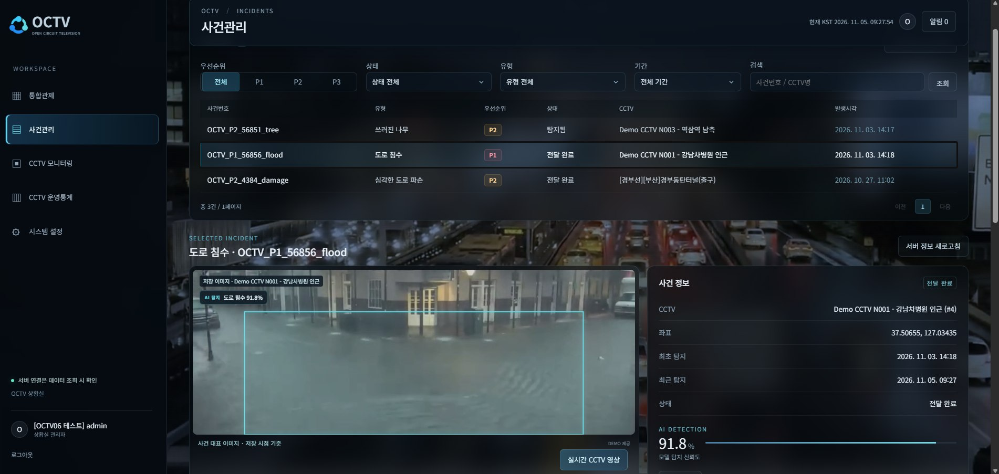
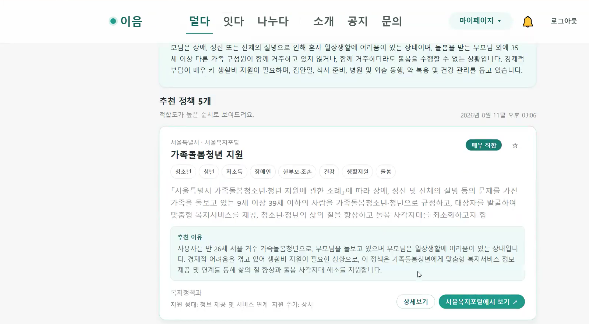

# 박수연 | 데이터·AI 포트폴리오

CCTV 영상으로 도로 재난을 탐지하고, 공공 정책 데이터로 가족돌봄청년에게 맞는 복지정책을 추천하는 서비스를 만들었습니다.

---

## OCTV
**CCTV 기반 도로 재난 탐지·대응 지원**  
2026.09.21 ~ 2026.11.03 · 2인 팀 프로젝트

**사건관리 화면.** 도로 침수 탐지 박스와 신뢰도, 사건 위치와 최근 탐지 시각을 한 화면에서 확인할 수 있습니다.

CCTV에서 도로 재난을 감지하고, 관제 담당자가 사건 정보와 대응 기관·출동 경로 추천을 확인할 수 있도록 만든 서비스입니다.

- **맡은 일** — 반복 탐지를 검증해 사건을 생성·갱신하는 흐름과 시스템 아키텍처를 설계했습니다. 학습 데이터 선별, 라벨 검수, 탐지 모델 비교에도 참여했습니다.
- **대표 결과** — 학습 데이터를 재구성하고 추가 학습 모델의 가중치를 결합했습니다. 동일 검증셋에서 쓰러진 나무 탐지율(Recall)은 **52.78% → 55.37%**, 전체 mAP50은 **75.14% → 76.43%**로 개선됐습니다.

**[OCTV 프로젝트 상세 보기 →](projects/OCTV.md)**

- [OCTV 시연 바로 보기 (3분 30초)](https://www.youtube.com/watch?v=r6f_p1V_ne0&t=210s)
- [OCTV 전체 발표 보기 (화면 녹화본)](https://www.youtube.com/watch?v=r6f_p1V_ne0)

---

## 이음(E-eum)
**가족돌봄청년 지원 서비스**  
2026.07.03 ~ 2026.08.11 · 3인 팀 프로젝트

**발표 시연 화면** · 사용자의 돌봄 상황에 맞는 복지정책을 추천하고, 추천 이유와 정책 원문 링크를 함께 제공합니다.

가족돌봄청년이 자신의 돌봄 상황에 맞는 복지정책을 찾고, 진로와 돌봄에 필요한 정보를 확인할 수 있도록 만든 서비스입니다.

- **맡은 일** — 복지정책 추천 기능 ‘덜다’의 데이터 처리, 검색·추천, 백엔드 개발을 담당했습니다.
- **대표 구현** — 3개 출처의 정책 데이터를 정규화해 동기화하고, 내용이 바뀐 정책만 다시 임베딩했습니다. 키워드 검색과 의미 검색 결과를 순위 기준으로 합치고, 추천 정책이 사용자 지역과 자격 조건에 맞는지 서버에서 다시 검증했습니다.

**[이음 정책 검색·추천 흐름과 구현 코드 보기 →](https://github.com/SY9507/E-eum)**

- [이음 시연 바로 보기 (약 3분 30초부터)](https://www.youtube.com/watch?v=uHLP0Lr0DRI&t=210s)
- [이음 전체 발표 보기 (화면 녹화본)](https://www.youtube.com/watch?v=uHLP0Lr0DRI)
