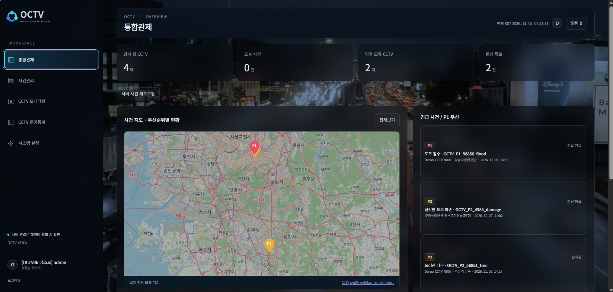
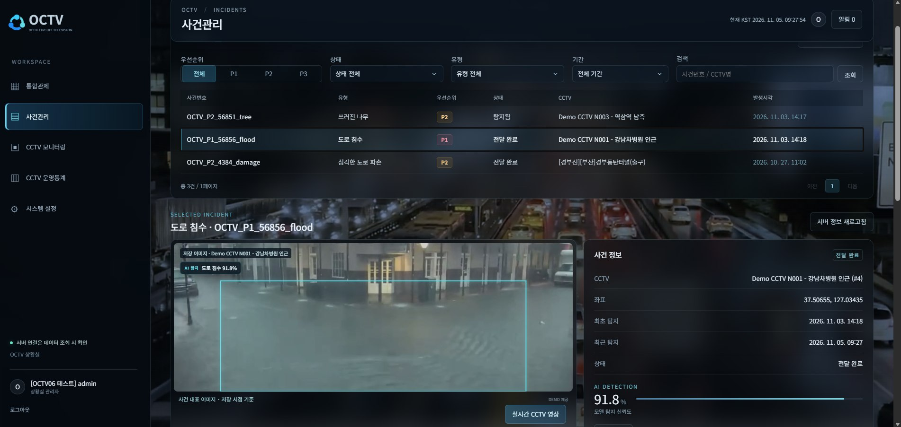
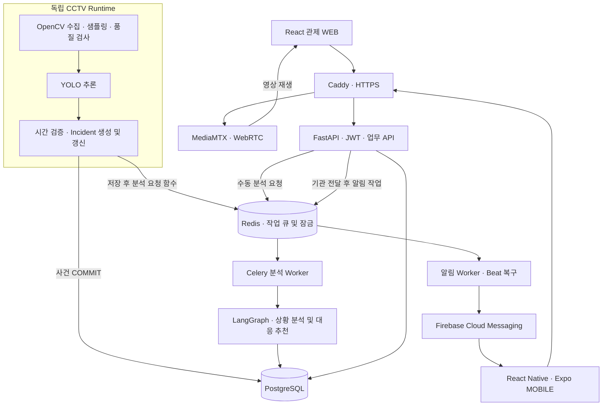
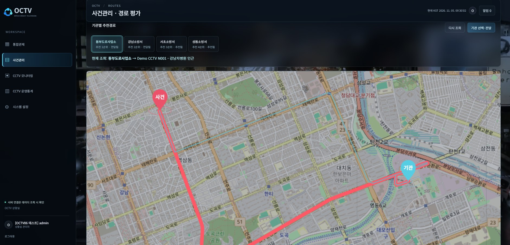
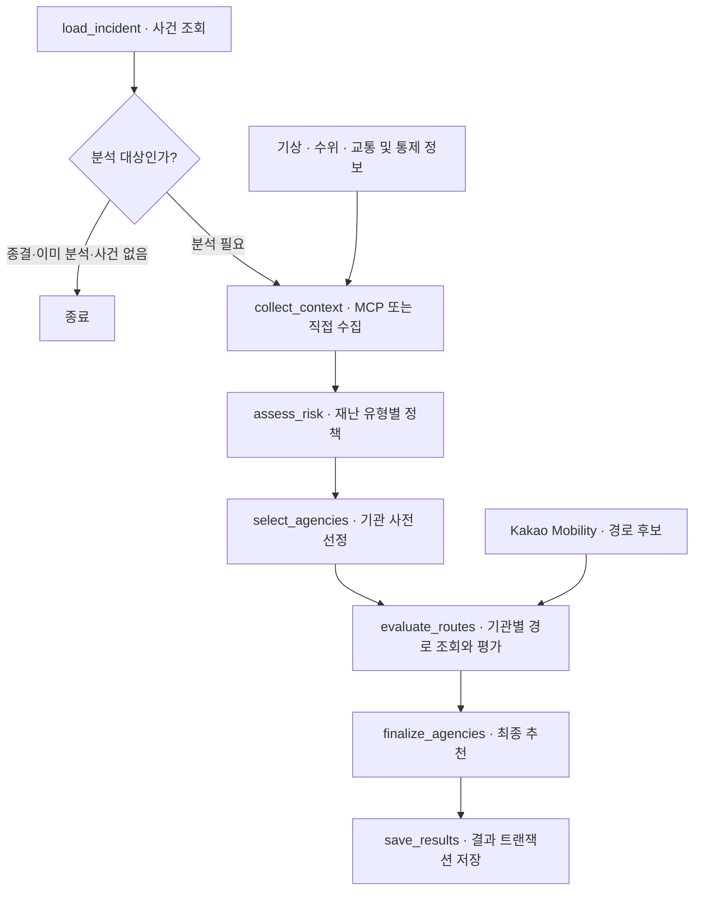
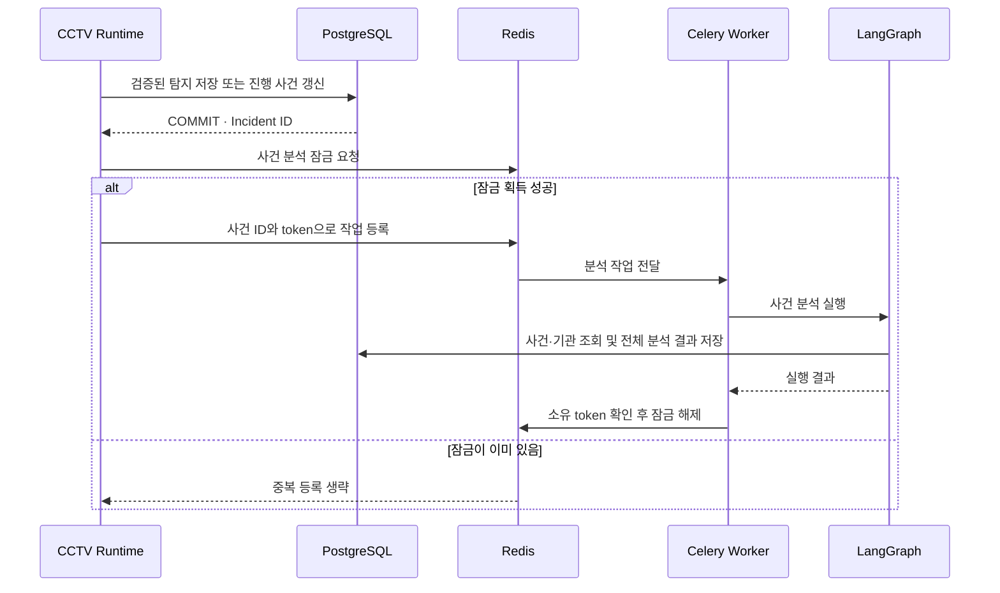
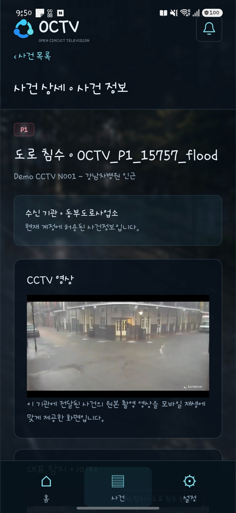
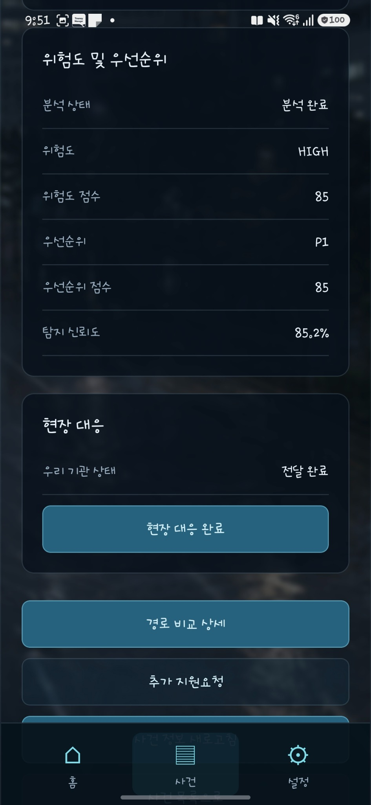
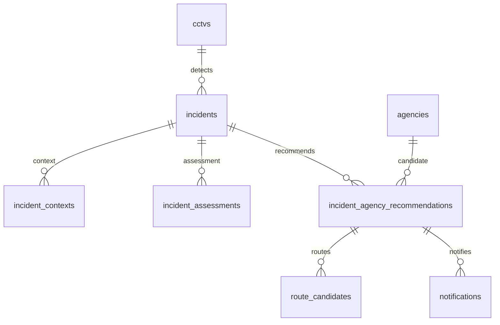

# OCTV
### CCTV 기반 도로 재난 탐지·대응 의사결정 지원 시스템

CCTV 영상에서 도로 위험 상황을 탐지하고, 사건 정보와 외부 상황 데이터를 연결해 관제 담당자의 대응 판단을 돕는 프로젝트입니다.

KDT 최종 팀 프로젝트 · 2인 · 2026.09.21 ~ 2026.11.03

> **My Role** — AI 탐지 결과의 사건 생성·갱신 흐름과 시스템 아키텍처를 담당했습니다. 데이터 선별·라벨 검수와 모델 학습 과정에도 참여했으며, 관제·모바일 화면 흐름과 스토리보드 일부를 설계했습니다.
>
> → [My Contribution](#-my-contribution) · [Architecture](#-system-architecture) · [Technical Decisions](#-technical-decisions)

---

## 목차

1. [프로젝트 배경](#-프로젝트-배경)
2. [서비스 구성](#-서비스-구성)
3. [My Contribution](#-my-contribution)
4. [System Architecture](#-system-architecture)
5. [Technical Decisions](#-technical-decisions)
6. [데이터와 데이터베이스](#-데이터와-데이터베이스)
7. [Tech Stack](#-tech-stack)
8. [한계 및 개선 방향](#-한계-및-개선-방향)

---

## 📌 프로젝트 배경

도로 재난을 CCTV에서 발견해도, 탐지 결과를 사건으로 관리하고 주변 기상·수위·교통 상황과 함께 판단해 담당 기관에 전달하기까지 여러 시스템과 수작업을 거칩니다. OCTV는 이 과정을 하나의 관제 흐름으로 연결하는 것을 목표로 했습니다.

서비스는 침수, 쓰러진 나무, 심각한 도로 파손, 도로 장애물을 다루며, AI 탐지 결과를 시간 기준으로 확인한 뒤 사건으로 저장하고 이후 위험도와 대응 정보를 붙이는 구조로 설계했습니다.

## 🧩 서비스 구성

**통합관제 화면.** 지도에서 사건 위치를 확인하고, 우측 목록에서 우선순위별 사건 상태를 살펴볼 수 있습니다.

| 영역 | 주요 역할 |
|---|---|
| 통합관제 WEB | CCTV·사건 현황 확인, 사건 상세와 대응 정보 검토 |
| 현장 MOBILE | 담당자용 사건 확인, 알림과 현장 대응 흐름 |
| AI 탐지·사건화 | 영상 프레임 처리, 객체 탐지, 시간 검증, 사건 생성·갱신 |
| 분석·대응 지원 | 외부 상황 정보 기반 위험도 판단, 기관·경로 추천을 위한 처리 구조 |
| 데이터 관리 | PostgreSQL 기반 사건·CCTV·기관·추천·알림 데이터 관리 |

---

## 🙋 My Contribution

### AI 탐지 결과의 사건화

- **탐지 후보 검증** — 재난 유형, 신뢰도, 박스 크기 등 후보 조건을 확인하고 시간 구간 내 반복 탐지를 검증해 사건으로 확정하는 흐름을 구현했습니다.
- **Incident 생성·갱신** — CCTV와 재난 유형, 위치·시간 기준의 중복 판별 정보를 사용해 같은 진행 사건은 갱신하고 새로운 상황은 별도 사건으로 관리하도록 연결했습니다.
- **오탐 재생성 억제** — 관리자가 오탐 처리한 동일 탐지가 짧은 시간 안에 반복될 때 새 사건이 즉시 생기지 않도록 억제 규칙을 반영했습니다.
- **저장 이후 분석 요청** — 사건 저장 트랜잭션이 끝난 뒤 별도 분석 작업을 요청하도록 API와 비동기 처리 경계를 연결했습니다.

### 데이터셋 재구성과 YOLO 모델 개선

1. **초기 모델의 미탐을 확인하고 학습 데이터셋을 재구성했습니다.** 초기 모델은 특히 쓰러진 나무를 자주 놓쳤습니다. 기존 침수 데이터를 유지하고, 나머지 유형은 새로 선별한 이미지로 학습 데이터를 다시 구성했습니다. 모델 예측을 가린 상태에서 원본 이미지와 기존 라벨을 대조하고, 재난으로 오인하기 쉬운 비재난 장면도 선별했습니다. 이 데이터로 비교의 출발점이 되는 모델을 다시 학습했습니다.
2. **추가 학습에서 일부 클래스의 성능이 떨어져 학습률을 낮췄습니다.** 데이터를 더 넣고 학습하자 일부 유형에서는 개선이 있었지만, 다른 유형은 놓치는 사례가 늘었습니다. 기존 모델의 성능을 최대한 유지하면서 새 데이터를 반영하기 위해 학습률을 0.0002로 낮추고, 학습 중 저장한 모델을 같은 검증 이미지로 다시 비교했습니다.
3. **추가 학습 모델을 그대로 교체하는 대신 두 모델의 가중치를 결합했습니다.** 낮은 학습률로 학습한 모델도 심각한 도로 파손 탐지율은 개선됐지만 쓰러진 나무 탐지율은 떨어졌습니다. 여러 결합 비율을 비교한 뒤, 데이터셋을 재구성해 학습한 모델의 가중치 71%와 추가 학습 5번째 에폭의 가중치 29%를 결합한 후보를 선택했습니다.

같은 검증 이미지에서 데이터셋을 재구성해 학습한 모델과 가중치를 결합한 후보를 비교했습니다.

| 지표 | 데이터 재구성 후 학습 | 추가 학습 후 가중치 결합 |
|---|---:|---:|
| 전체 mAP50 | 75.14% | 76.43% |
| 전체 mAP50–95 | 51.57% | 53.07% |
| 쓰러진 나무 탐지율 (Recall) | 52.78% | 55.37% |

가중치를 결합한 후보는 데이터 재구성 직후 모델보다 쓰러진 나무 탐지율이 약 2.6%p 높았고, 전체 탐지 성능도 두 mAP 지표에서 개선됐습니다.

### 시스템 설계와 사용자 흐름

- CCTV 감시와 관제 API의 역할을 나누고, 사용자 접속 여부와 무관하게 감시 흐름을 운영할 수 있도록 프로세스 구성을 설계했습니다.
- 사건 생성부터 관제 확인, AI 분석 결과 확인, 기관 전달과 현장 대응까지 WEB·MOBILE 화면 흐름과 스토리보드를 정리했습니다.
- 팀원이 담당한 LangGraph 분석 내부 정책과 노드 설계는 제 기여와 구분했습니다. 저는 사건 저장 후 분석 작업을 연결하는 인터페이스와 운영 흐름을 맡았습니다.

---

### 탐지 결과를 관제 화면의 사건으로 연결

**사건관리 화면.** 도로 침수 탐지 박스와 신뢰도, 사건 위치와 최근 탐지 시각을 한 화면에서 확인할 수 있습니다.

CCTV에서 쓰러진 나무를 탐지해 사건이 생성되면, 관제 담당자는 분석이 끝나기 전에도 **어느 CCTV에서 언제 무엇이 탐지됐는지** 확인할 수 있습니다. 사건 상세에는 대표 이미지와 탐지 위치를 표시한 박스가 함께 표시됩니다.

| 상황 | 관제 화면에서 확인할 수 있는 내용 |
|---|---|
| 같은 위험이 다시 탐지됐을 때 | 진행 중인 같은 사건의 최근 탐지 시각을 갱신합니다. 더 최신 대표 이미지가 들어오면 그 이미지에 맞는 탐지 박스와 신뢰도도 함께 바뀝니다. |
| 후속 분석이 끝났을 때 | 같은 사건에서 위험도·대응 우선순위와 판단 근거를 확인할 수 있습니다. |
| 담당자가 오탐으로 처리했을 때 | 기본 목록에서 빠지고, 오탐 상태를 선택하면 이력을 다시 확인할 수 있습니다. |

### 비동기 분석 연동

사건을 저장한 후, **‘탐지됨’ 또는 ‘확인됨’ 상태이면서 아직 위험도 점수가 없는 사건**을 분석 대상으로 봅니다. 같은 사건의 분석이 이미 대기 중이거나 실행 중이면 Redis 잠금으로 중복 등록을 막습니다.

등록된 작업은 별도 Celery Worker가 처리합니다. Worker는 사건 ID를 받아 팀원이 구현한 LangGraph 분석을 실행합니다. 이 분석은 사건의 위험도를 판단하고 대응 기관과 출동 경로를 추천합니다.

저는 **사건 저장 후 분석 요청을 보내는 흐름과 중복 등록 방지, 일시적인 오류에 대한 재시도**를 구현했습니다. 재시도할 때는 잠금을 유지하고, 분석이 완료되거나 최종 실패하면 해제합니다.

---

## 🏗 System Architecture

프로젝트는 개발과 배포를 완료했습니다. 운영 Compose는 API, 분석 Worker, CCTV Runtime, 웹, PostgreSQL, Redis, MediaMTX, Caddy를 별도 서비스로 구성합니다. 알림 Worker·Beat·CCTV Runtime 등은 Compose profile로 실행 여부를 선택합니다.

CCTV Runtime은 사건을 저장한 후 Python 함수로 분석 작업을 발행합니다. API와 감시 Runtime은 분리된 서비스이며, 분석과 알림도 전용 큐와 Worker로 실행합니다.

### 상황 분석·기관·경로 추천 흐름

**기관별 경로 평가 화면.** 관제 담당자가 추천 기관을 선택하면 해당 기관에서 사건 위치까지의 추천 출동 경로를 지도에서 확인할 수 있습니다.

팀원이 담당한 분석 영역은 다음 7개 LangGraph 노드로 구성됩니다. 전체 시스템 설명에 이 흐름을 포함하고, 개인 기여는 My Contribution에서 설명합니다.

- **외부 상황 수집** — 사건별 ContextSnapshot에 측정값과 상태를 모으고, 설정에 따라 MCP 또는 직접 호출로 수집합니다.
- **위험도 분석** — 재난 유형에 맞는 정책을 적용합니다. 탐지 신뢰도와 외부 상황 기반 위험도는 서로 다른 정보로 다룹니다.
- **기관·경로 결합** — 기관을 사전 선정한 뒤 기관별 경로 API 요청을 최대 4개 스레드로 병렬 처리합니다. 각 기관의 경로 후보는 최대 3개를 검증하고 평가한 뒤 최종 기관 추천에 반영합니다.
- **통제 정보 검증** — GeoJSON 좌표·도형을 검사하고, 미확인 통제 정보를 정상적인 빈 통제 목록으로 바꾸지 않습니다.
- **결과 저장** — 전체 분석 결과를 하나의 트랜잭션으로 저장해 관제 화면에서 조회합니다.

---

## 🔧 Technical Decisions

### 1. 한 번의 탐지로 사건을 만들지 않도록 시간 검증

**문제**  
CCTV 프레임 한 장의 탐지는 그림자, 흔들림, 일시적인 가림 등으로 오탐이 생길 수 있습니다.

**접근**  
신뢰도와 탐지 박스 크기 조건을 통과한 첫 탐지는 후보로 기록합니다. 이후 프레임에서도 비슷한 위치에 같은 유형의 위험이 반복해서 감지되면 사건으로 등록합니다. 검증 시간과 최소 탐지 횟수는 설정으로 조정할 수 있습니다. *(코드 기본값은 15초 이내 최소 3회입니다.)*

**효과**  
단일 프레임 결과와 실제 관리 대상 사건을 분리하고, 사건 생성 조건을 설정값으로 관리할 수 있습니다.

### 2. DB 저장과 AI 분석 요청을 분리

**문제**  
탐지한 사건은 후속 AI 분석에 문제가 생겨도 관제 담당자가 확인할 수 있어야 합니다.

**접근**  
사건을 DB에 먼저 저장합니다. 저장이 확정되면 별도로 AI 분석을 요청합니다. Redis 연결 오류로 분석 요청을 전달하지 못하면, 연결이 복구된 뒤 다시 요청할 수 있습니다.

**효과**  
분석 요청이 실패해도 저장된 사건은 관제 화면에서 확인할 수 있습니다.

### 3. Redis 잠금으로 중복 분석 방지

**문제**  
같은 사건에 대한 분석 요청이 연달아 들어오면, 같은 작업이 Celery 대기열에 여러 번 등록될 수 있습니다.

**접근**  
분석 작업을 등록하기 전에 Redis에 사건 번호별 잠금을 겁니다. 이미 잠금이 있으면 같은 사건의 분석이 대기 중이거나 진행 중으로 보고 추가로 등록하지 않습니다.

잠금마다 고유한 식별값을 붙여 분석 작업에 전달합니다. 작업을 처리하는 Worker는 분석을 마칠 때 자신이 받은 식별값과 Redis에 남아 있는 값이 일치할 경우에만 잠금을 풉니다. 작업 등록에 실패하면 요청을 보낸 쪽에서 잠금을 풀고, Worker가 중단된 경우를 대비해 잠금에 만료 시간도 설정합니다.

**효과**  
같은 사건의 분석이 대기 중이거나 진행 중일 때, 요청이 다시 들어와도 분석 작업을 추가로 등록하지 않습니다.

### 4. 프로세스 재시작 뒤 감시 모드 복구

평상시 감시 중인 CCTV에서 쓰러진 나무 후보가 감지되면, 같은 위험이 반복해서 보이는지 확인하기 위해 잠시 검증 모드로 전환합니다. 검증 도중 감시 프로그램이 갑자기 종료되면, 재시작 후에도 CCTV에 검증 모드가 남아 있을 수 있습니다.

이를 대비해 검증 모드로 바꾸기 전에 기존 감시 모드를 Redis에 기록했습니다. 프로그램이 다시 시작되면 이 기록을 읽어, 평상시 감시 중이던 CCTV는 평상시 모드로, 기상특보로 감시 중이던 CCTV는 특보 모드로 되돌립니다.

---

### 5. 같은 위험이 반복 탐지되면 기존 사건 갱신

**문제**  
한 CCTV에서 같은 재난이 반복해서 감지될 때마다 새 사건을 만들면, 관제 목록에 같은 상황이 여러 건으로 쌓입니다.

**구현**  
같은 CCTV에서 동일한 위험이 다시 감지되면, 진행 중인 사건이 있는지 확인합니다. 예를 들어 10시에 등록한 침수가 10시 1분에 다시 감지되면, 새 사건을 만들지 않고 기존 사건의 최근 탐지 시각을 10시 1분으로 갱신합니다. 이전에 찍힌 탐지 결과가 뒤늦게 들어와도 최근 시각은 그대로 유지합니다.

대표 이미지를 더 최신 이미지로 바꿀 때는 그 이미지에 맞는 탐지 박스, 신뢰도, 모델 버전도 함께 갱신합니다.

**효과**  
관제 담당자는 반복 탐지를 한 사건에서 확인할 수 있습니다. 사건을 종결한 뒤 같은 장소에서 다시 위험이 감지되면 새 사건으로 기록할 수 있습니다.

### 6. 오탐 버튼을 눌러도 사건이 재생성되는 문제 → 탐지 중단 간격으로 재활성화

**문제**  
관제 담당자가 오탐으로 표시한 장면을 AI가 계속 감지하면, 관제 목록에 같은 오탐이 새 사건으로 다시 등록될 수 있습니다.

**구현**  
새 사건을 등록하기 전에 같은 CCTV에서 같은 유형으로 감지된 위험 후보가 이미 오탐으로 처리됐는지 확인합니다. 이때 이전 탐지와 같은 후보인지 구분하기 위해 같은 상황인지 판별하는 값도 함께 비교합니다. 마지막 탐지로부터 60초 이내에 다시 감지되면 기존 오탐 기록의 **마지막 탐지 시각**만 갱신합니다.

예를 들어 같은 장면이 10시 00분 10초와 10시 00분 50초에 감지됐다면, 다음 탐지는 **10시 00분 50초부터** 시간을 계산합니다. 이렇게 같은 장면이 60초 이내 간격으로 계속 감지되는 동안에는 새 사건이 생기지 않습니다. 마지막 탐지 이후 60초를 넘겨 다시 감지되면, 사건 생성 조건을 충족할 때 새 사건으로 등록할 수 있습니다.

**효과**  
관제 담당자가 같은 장면을 반복해서 오탐 처리하는 부담을 줄이고, 한동안 감지되지 않다가 다시 나타난 상황은 새 사건으로 확인할 수 있습니다.

### 7. AI가 처리하기 전에 영상이 쌓이는 문제 → 오래된 대기 영상 정리

**문제와 판단**

CCTV 영상은 AI가 분석하는 속도보다 빠르게 들어올 수 있습니다. 들어온 영상을 모두 기다리게 두면 대기열이 길어져, AI가 현재보다 한참 전의 장면을 분석하게 됩니다.

**구현**

분석을 기다리는 영상 수에 제한을 둡니다. 대기열이 가득 찬 상태에서 새 영상이 들어오면, 가장 오래 기다린 영상을 버리고 새 영상을 넣습니다. 이렇게 하면 분석을 기다리는 동안 오래된 장면이 계속 쌓이는 것을 줄일 수 있습니다.

여러 CCTV의 영상이 동시에 들어와도 대기열이 안전하게 갱신되도록 잠금을 사용합니다. 영상의 대기 시간을 잴 때는 컴퓨터 시각이 바뀌어도 경과 시간을 안정적으로 계산할 수 있는 시계를 사용합니다.

**결과와 한계**

오래된 영상이 대기열에 계속 쌓이는 것을 막아, AI가 지나간 장면을 뒤늦게 분석하는 상황을 줄입니다. 대신 부하가 클 때 일부 영상은 건너뜁니다. 이 방식이 실제 분석 지연을 얼마나 줄이는지는 별도 측정이 필요합니다.

## 🔄 사건 생성부터 분석 완료까지

사건은 DB에 먼저 저장하고, 저장이 끝나면 분석 작업을 큐에 등록합니다. 같은 사건의 작업이 이미 대기 중이거나 실행 중이면 중복 등록하지 않습니다. 큐 등록에 실패하면 잠금을 풀어 이후 다시 요청할 수 있게 합니다. 다만 사건 저장 직후 프로그램이 종료되면 사건은 저장되어도 분석 작업은 등록되지 않을 수 있습니다. 이 경우까지 자동으로 복구하려면 별도의 복구 구조가 필요합니다.

## 🚒 관제 확인과 현장 대응

탐지된 사건을 관제 담당자가 확인하고, 분석 결과를 검토한 뒤 대응 기관과 현장 담당자에게 전달하는 흐름입니다.

| 단계 | 시스템 처리 | 사용자에게 보이는 정보 |
|---|---|---|
| 사건 확인 | 관제 담당자가 확인 요청을 보내면 사건 상태를 갱신합니다. 사건에 연결된 탐지 정보와 대표 이미지를 조회합니다. | 탐지 이미지와 위치, 재난 유형, 발생 시각 |
| 분석 결과 확인 | 사건에 대한 분석이 끝나면 위험도와 우선순위, 추천 기관과 경로, 판단 근거를 조회해 사건에 연결합니다. | 위험도·우선순위, 추천 결과와 판단 근거 |
| 기관 전달 | 기관에 사건을 전달하고 전달 기록과 알림 기록을 데이터베이스에 저장합니다. 저장이 완료된 뒤 알림 번호를 발송 대기열에 등록합니다. | 전달된 사건과 담당 기관 |
| 모바일 알림 | 발송 작업을 받은 Worker가 담당 기관과 사용자 상태, 알림 설정, 등록된 휴대폰 정보를 다시 확인한 뒤 FCM으로 알림을 보냅니다. 기기별 발송 결과를 기록하고, 일시적인 오류가 난 기기는 제한적으로 재시도합니다. | 현장 담당자의 휴대폰에 도착한 사건 알림 |
| 대응 완료 | 기관별 대응 상태를 확인하고, 사건 종결 조건을 충족하면 사건을 완료 상태로 변경합니다. | 기관별 대응 상태와 사건 완료 여부 |

기관에 사건을 전달하면 **서비스 안에서 확인할 알림 기록**을 데이터베이스에 저장하고, 휴대폰 알림 발송은 별도 작업으로 진행합니다. 따라서 휴대폰 알림 발송에 실패해도 서비스 안의 알림 기록은 남습니다.

발송 작업을 처리하는 프로그램은 알림을 보내기 전에 담당자의 소속과 계정 상태, 알림 설정, 등록된 휴대폰 정보를 다시 확인합니다. 일시적인 전송 오류가 난 기기는 정해진 횟수 안에서 재시도합니다.

설정에 따라 **Celery Beat**가 주기적으로 발송이 누락되었거나 재시도가 필요한 알림을 찾아 발송 대기열에 다시 등록합니다. Beat는 복구 작업을 예약하고, 실제 발송은 별도 프로그램인 Worker가 처리합니다.

### 현장 담당자 모바일 화면

| 전달받은 사건 확인 | 위험도 확인과 현장 대응 |
| --- | --- |
|  |  |
| 현장 담당자가 전달받은 도로 침수 사건의 수신 기관과 CCTV 영상을 확인합니다. | 위험도와 우선순위를 확인한 뒤 출동 경로를 비교하거나 현장 대응을 완료 처리할 수 있습니다. |

## 🗄 데이터와 데이터베이스

PostgreSQL에 사건·상황·평가·기관·경로·알림 정보를 저장합니다. 

| 데이터 영역 | 주요 정보 |
|---|---|
| CCTV·기상특보 | CCTV 위치·감시 모드, 특보 정보 |
| 사건 | 유형·상태·신뢰도·좌표·탐지 시각·대표 이미지 |
| 상황·평가 | 사건 시점의 외부 정보와 위험도 판단 |
| 기관·경로 추천 | 추천 기관, 경로 후보, 선택 근거 |
| 알림·지원 요청 | 전달 상태와 현장 지원 요청 |

DB 정의는 기능별 SQL 파일로 관리하고, 공통 연결은 psycopg 트랜잭션으로 처리합니다. 기존 DB 변경은 백업과 검증 절차를 거치도록 구성했습니다.

---

### 핵심 데이터 관계

| 설계 포인트 | 목적 |
|---|---|
| 사건과 평가 분리 | 탐지 기록을 먼저 남기고 분석 결과를 이후에 연결 |
| 진행 사건의 중복 제약 | 같은 상황의 반복 탐지를 기존 사건에 반영 |
| 대표 이미지와 탐지 정보 동시 갱신 | 이미지·박스·모델 버전의 일관성 유지 |
| 기관 전달 관계 기반 조회 | 현장 사용자가 본인 기관에 전달된 사건을 조회 |
| 사건 행 잠금 후 완료 판단 | 여러 기관의 동시 완료 요청을 직렬화 |

---

## 🛠 Tech Stack

| 영역 | 기술 | 사용 목적 |
|---|---|---|
| AI / 영상 | Python, PyTorch, Ultralytics YOLO, OpenCV | 영상 프레임 처리와 객체 탐지 |
| 분석 흐름 | LangGraph, FastMCP | 사건 분석 단계와 도구 연결 구조 |
| Backend | FastAPI, Pydantic, psycopg | API와 데이터 검증, PostgreSQL 접근 |
| 비동기 작업 | Redis, Celery | 사건 후속 분석 작업 전달 |
| Database | PostgreSQL | 사건·상황·기관·경로·알림 데이터 관리 |
| Frontend | React, TypeScript, Vite | 관제 WEB |
| Mobile | React Native, Expo | 현장 담당자용 앱 |
| Infra / Collaboration | Docker Compose, Git, GitHub Actions | 개발 환경과 버전 관리·검증 |

---

## 🧭 한계 및 개선 방향

| 현재 설계의 제약 | 개선 방향 |
|---|---|
| 사건 COMMIT 이후 분석 작업을 별도로 발행 | Transactional Outbox로 DB 저장과 발행 대상을 함께 기록하고 미발행 작업 복구 |
| 분석 Lock은 고정 TTL 사용 | 장기 실행·강제 종료 상황을 기준으로 TTL과 갱신 정책 검토 |
| 부하가 높으면 오래된 프레임 생략 | CCTV 수별 대기 시간·추론 시간·탐지 누락을 함께 측정해 샘플링 조정 |
| 이미지 학습 결과와 실제 CCTV 환경 간 차이 | 야간·우천·원거리 장면을 구분한 평가와 실제 오탐 기반 데이터 보강 |
| 데이터·가중치를 Git 외부에서 관리 | 데이터 버전·학습 설정·모델 평가 결과를 연결한 실험 기록 정리 |

---

## 👥 Team

KDT 최종 팀 프로젝트 · 2인

- **내 담당** — AI 탐지 결과의 사건 생성·갱신 흐름, 데이터·모델 개선 작업, 시스템 아키텍처, 관제·모바일 스토리보드 일부
- **팀원 담당 분석 영역** — 외부 상황 수집, 재난 유형별 위험도 정책, 기관 사전 선정, 경로 후보 평가, 최종 기관 추천, LangGraph 실행 흐름과 분석 결과 저장.
